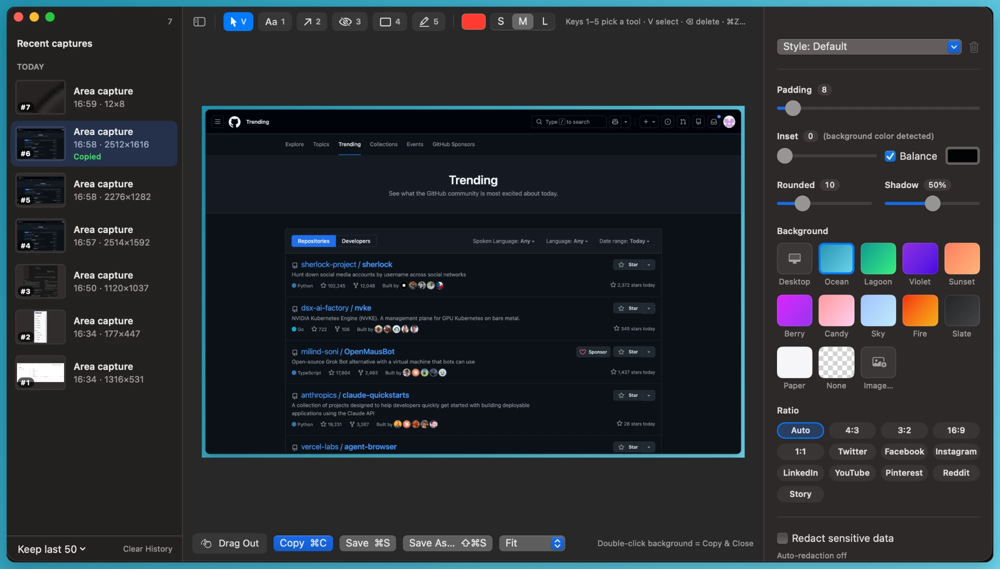
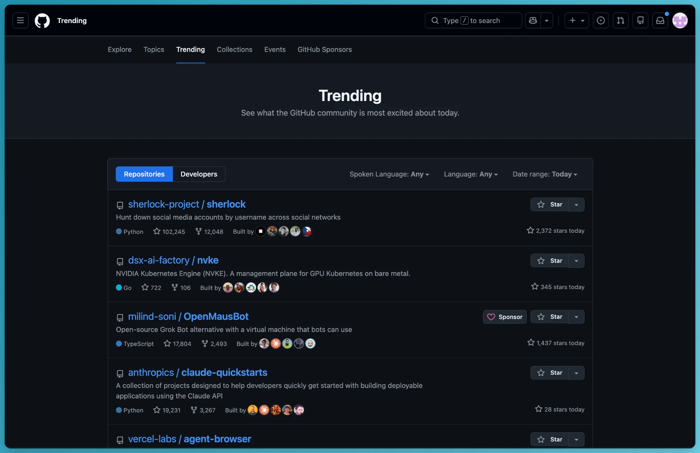

# PrimeSnap

A small, fast screenshot beautifier for macOS. Capture, frame, annotate, redact, copy. Native Swift, no dependencies, no account, no network.



<details>
<summary>What ⌘C puts on your clipboard</summary>



</details>

## Features

- **Capture** an area, a window or the whole screen with global shortcuts (from the menu bar).
- **Frame** it: gradient, wallpaper or image backgrounds, padding, rounded corners, shadow, and aspect ratios for Twitter/X, LinkedIn, Instagram, YouTube and more.
- **Annotate** with text, arrows, boxes and highlights.
- **Redact** by hand, or automatically: on-device OCR hides emails, IP addresses, phone and card numbers, and API keys/tokens (pixelate, blur or solid).
- **One window, recent captures in a sidebar.** Every capture is numbered and keeps its edits, so you can go back and re-copy.
- **Copy (⌘C), save (⌘S) or drag** the finished image straight into Slack, Mail or Finder.
- Light: one ~2 MB app, idle in the menu bar, Dock icon only while a window is open.

## Install

1. Download **`PrimeSnap.dmg`** from the [latest release](https://github.com/nivohavi/primesnap/releases/latest).
2. Open it and drag **PrimeSnap** onto **Applications**. (A `.zip` is there too, if you prefer.)
3. The first time, **right-click the app → Open → Open**. Release builds aren't notarized by Apple (that needs a paid developer account), so a normal double-click is blocked the first time.
4. Allow **Screen & System Audio Recording** when asked (System Settings → Privacy & Security), then relaunch PrimeSnap.

Requires macOS 14 Sonoma or later.

> Because release builds are ad-hoc signed, macOS may ask for Screen Recording again after you update to a new version.

## Use

| Shortcut | Action |
|---|---|
| ⌃⇧2 | Capture area (Space switches to window picking) |
| ⌃⇧3 | Capture window |
| ⌃⇧1 | Capture screen |

Change them in **Settings → Shortcuts**. In the editor:

| Key | Action |
|---|---|
| ⌘C | Copy image |
| ⌘S / ⇧⌘S | Save to your save folder / Save As |
| V, 1–5 | Select, Text, Arrow, Redact, Box, Highlight |
| ⌘Z / ⇧⌘Z | Undo / Redo |
| ⌘0 ⌘1 ⌘+ ⌘− | Fit, 100%, zoom in, zoom out |
| ⌘\ | Show/hide recent captures |
| Esc | Deselect, then hide the window |

Double-click the background to copy and close.

## Privacy

Nothing leaves your Mac. Text recognition for auto-redaction runs on-device with Apple's Vision framework, and is off by default. Recent captures are stored in `~/Library/Application Support/PrimeSnap/History` (keep 5–1,000, set in Settings → History).

## Build from source

```sh
git clone https://github.com/nivohavi/primesnap.git
cd primesnap
scripts/build-app.sh            # -> build/PrimeSnap.app
scripts/build-app.sh --install  # copy to /Applications and launch
scripts/make-dmg.sh             # -> build/PrimeSnap.dmg (after build-app.sh)
```

Needs Xcode 15.4+ (Swift 5.10).

**Keep the Screen Recording permission across rebuilds.** macOS ties the permission to the app's code signature. Ad-hoc builds get a new signature every time, so the permission resets on every build. Create a free, local signing identity once:

```sh
scripts/make-signing-cert.sh
```

`build-app.sh` then signs with it (or with `$SIGN_IDENTITY`, or an Apple development identity if you have one).

## Project layout

| File | What it does |
|---|---|
| `Capture.swift` | Wraps `/usr/sbin/screencapture` |
| `Redactor.swift` | OCR + pattern detection; pixelate/blur/solid via Core Image |
| `Renderer.swift` | Background, padding, corners, shadow, aspect ratio, annotations (Core Graphics) |
| `EditorModel.swift` | Editor state, undo, export; caches the redacted image so sliders only recomposite |
| `History.swift` / `Workspace.swift` | Recent captures on disk and the single editor window |
| `EditorView.swift`, `EditorSidebar.swift` | SwiftUI editor |
| `SettingsWindow.swift`, `Prefs.swift` | Settings |
| `HotKey.swift` | Global shortcuts (Carbon) |

## License

[MIT](LICENSE)
